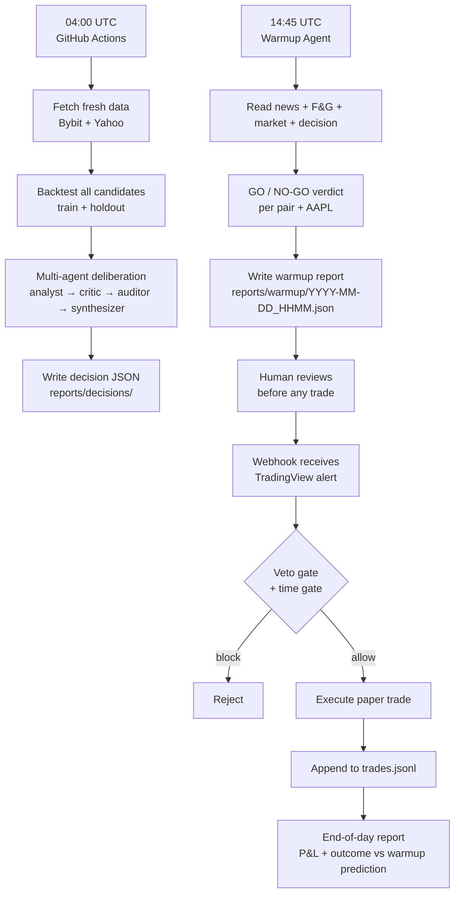

# TRADE PLAN — From Paper to Professional Trader

**Built:** 2026-10-22 | **Account:** farisjagpher (TradingView Paper, $100k)
**Goal:** Build a systematic trading system that runs daily in paper mode,
writes every observation, and only graduates to real capital after 90+ days
of verified edge.

---

## 1. Where We Are Now

### What works (verified today)

| Component | Status | Evidence |
|-----------|--------|----------|
| Crypto research harness | **Live** | `sma_trend_period200` champion, +29% holdout CAGR on Bybit |
| Multi-agent deliberation | **Live** | analyst → critic → auditor → synthesizer, 4h cycle on GitHub Actions |
| TradingView webhook | **Live** | Receives alerts, routes to crypto or equity path |
| AAPL equity strategies | **Coded** | 2 families, 148 candidates, tested on real Yahoo data |
| AAPL backtest (real data) | **Run** | 48 runs, best +3.96% CAGR vs B&H +21.99% |
| Trade Agent (warmup) | **Built** | Reads news + market + deliberation, outputs GO/NO-GO |

### What's missing

| Gap | Why it matters |
|-----|---------------|
| No daily warmup schedule | The Trade Agent exists but isn't run every market day |
| No AAPL 1m data feed | Yahoo only serves 7 days of 1m — the scalp can't run at its design timeframe |
| No intrabar TP/SL engine | Current engine is position-only; the $0.50/$0.75 rules can't be tested |
| No news/prediction pipeline | GDELT sentiment exists but isn't wired into the daily loop |
| No outcome tracking | We don't record whether warmup GO/NO-GO was correct |
| No graduation criteria | No explicit rule for when paper → real money |

---

## 2. The Daily Loop (what runs every market day)



### Schedule (UTC)

| Time | What | Where |
|------|------|-------|
| 00:00, 04:00, 08:00, 12:00, 16:00, 20:00 | Research + deliberation | GitHub Actions |
| 14:45 (Mon-Fri) | Warmup before US open | This PC / cron |
| 15:30 (Mon-Fri) | Post-warmup AAPL scan | This PC / cron |
| 21:00 (Mon-Fri) | End-of-day outcome report | This PC / cron |
| Any time | TradingView alert → webhook | Render |

---

## 3. The Trade Agent (warmup before every trade)

**File:** `agents/trade_agent.py`
**Runner:** `run_warmup.py`

The Trade Agent is the "read the news and check the chart" step. It runs
~15 min before the US open and produces a GO/NO-GO verdict per pair.

### What it reads (all with citations)

| Source | What it pulls | Why it matters |
|--------|--------------|----------------|
| Fear & Greed Index | 0-100 sentiment, 7d change | Extreme fear = contrarian buy; extreme greed = caution |
| GDELT news tone | 24h + 7d tone per query | Negative news flow → stay out |
| Reddit sentiment | post counts, scores | Retail crowd sentiment |
| Market agent | price, EMA50/200, regime, ATR%, volume z-score, order book | Technical state |
| Deliberation decision | latest allow/block per pair | Multi-agent consensus |

### Scoring logic

```
regime=bull   → +2
regime=bear   → -2  (blocker)
F&G <= 25     → +1  (fear = contrarian edge)
F&G >= 75     → -1  (blocker: extreme greed)
GDELT tone < 0 → -1 per query (blocker)
Deliberation block → -3 (blocker)

GO if score >= 1, else NO-GO
```

### Running it

```bash
# Crypto pairs
python run_warmup.py

# Crypto + AAPL equity
python run_warmup.py --all

# Single pair, JSON output
python -m agents.trade_agent --pair BTC/USDT --json
```

Output: `reports/warmup/YYYY-MM-DD_HHMM.json` + appended to `warmup_log.jsonl`.

---

## 4. News & Prediction Pipeline

### What we have

- **GDELT** — global news tone by query (already wired into `news_agent.py`)
- **Fear & Greed** — CSV + SQLite (already wired)
- **Reddit** — post counts and scores (already wired)
- **Market agent** — price, regime, order book (already wired)

### What we need to add

| Feature | How | Priority |
|---------|-----|----------|
| News summary per symbol | GDELT query per ticker (AAPL, BTC, etc.) | HIGH |
| Macro event calendar | Economic calendar API (free tier) | HIGH |
| War/geopolitics tracker | GDELT tone on conflict keywords | MEDIUM |
| Earnings calendar | AAPL earnings date awareness | MEDIUM |
| Prediction log | Record warmup GO/NO-GO, compare to actual outcome | HIGH |

### The prediction loop

The system doesn't need to predict the future. It needs to **record its
opinion and check it later**:

1. Warmup writes GO/NO-GO + score + blockers
2. At end of day, compare: did the price move in the expected direction?
3. Log the outcome to `reports/warmup/outcome_log.jsonl`
4. After 90 days, calculate: was the warmup signal predictive?

If the warmup is predictive, it becomes a real edge. If not, the scoring
weights get re-tuned. Either way, the feedback loop is the point.

---

## 5. The Graduation Path (paper → real)

### Phase 1: Paper Trading (NOW → 90 days)

| What | How |
|------|-----|
| Daily warmup | `python run_warmup.py` every market day at 14:45 UTC |
| Trade via TradingView alerts | Webhook on Render, paper broker with $100k |
| Record everything | trades.jsonl + warmup_log.jsonl + outcome_log.jsonl |
| Weekly review | `btsum.py` aggregates P&L, win rate, warmup accuracy |
| Monthly strategy refresh | `python -m research.run_daily` promotes/demotes strategies |

### Phase 2: Review (after 90 days)

Check all of these before touching real money:

- [ ] Warmup GO/NO-GO accuracy > 55% (better than coin flip)
- [ ] Strategy P&L positive after costs
- [ ] Max drawdown < 20%
- [ ] No single trade > 5% of account
- [ ] At least 100 trades recorded
- [ ] All deliberation decisions have evidence citations
- [ ] No unresolved blocker in the last 30 warmup runs

### Phase 3: Real money (only if Phase 2 passes)

- Start with $500 (1% of account if $50k)
- Same rules, same webhook, same everything
- Scale only after 30 more profitable days

---

## 6. What "Seeing Things Clearly Behind the Curtain" Means

The system is designed so that the Trade Agent is the single interface.
You don't need to read 14 files or check 6 dashboards. You run:

```bash
python run_warmup.py --all
```

And it tells you: GO or NO-GO, for every pair, with the evidence attached.
The "curtain" is the multi-agent deliberation + news + market data — all
of it summarised into one verdict per symbol.

The key design principle: **the agent never trades on its own**. It reads,
it scores, it writes. A human (or the TradingView alert) triggers the trade.
The agent is the warmup, not the engine.

---

## 7. Cron Schedule (this PC)

Add to `crontab -e` (Linux/VPS) or Task Scheduler (Windows):

```bash
# Market days only (Mon-Fri)
# 14:45 UTC = 9:45 AM ET — warmup before US open
45 14 * * 1-5 cd /d/AlphaCode/Workspace/_repro/tb && python run_warmup.py --all >> reports/warmup/cron.log 2>&1

# 20:55 UTC = 4:55 PM ET — end-of-day outcome report
55 20 * * 1-5 cd /d/AlphaCode/Workspace/_repro/tb && python run_outcome.py >> reports/warmup/cron.log 2>&1

# 21:00 UTC — AAPL 1m scan (if data available)
0 21 * * 1-5 cd /d/AlphaCode/Workspace/_repro/tb && python run_aapl_backtest.py --full >> research/reports/aapl_daily.log 2>&1
```

For GitHub Actions (always-on, PC off), the existing workflow already runs
research + deliberation every 4 hours. Add the warmup step:

```yaml
- name: Pre-market warmup
  run: python run_warmup.py --all
```

---

## 8. Files Inventory

| File | Purpose | Runs on |
|------|---------|---------|
| `agents/trade_agent.py` | Pre-trade warmup (GO/NO-GO) | This PC / cron |
| `run_warmup.py` | Daily warmup runner for all pairs | This PC / cron |
| `run_outcome.py` | End-of-day outcome tracker (TODO) | This PC / cron |
| `run_aapl_backtest.py` | AAPL backtest on real Yahoo data | This PC / cron |
| `research/run_daily.py` | Full research harness (backtest + DSR + champion) | GitHub Actions |
| `agents/deliberate.py` | Multi-agent deliberation (analyst → critic → auditor → synthesizer) | GitHub Actions |
| `webhook_server.py` | TradingView webhook receiver + paper broker | Render |
| `agents/news_agent.py` | News/sentiment analysis (GDELT + F&G + Reddit) | Called by trade_agent |
| `agents/market_agent.py` | Market state (price, regime, order book) | Called by trade_agent |
| `TRADE_PLAN.md` | This file — the master plan | Reference |

---

## 9. Immediate Next Steps

| # | Action | Command | Priority |
|---|--------|---------|----------|
| 1 | Run warmup for all pairs | `python run_warmup.py --all` | TODAY |
| 2 | Write outcome tracker | Create `run_outcome.py` | TODAY |
| 3 | Add AAPL to GDELT queries | Edit `news_agent.py` | THIS WEEK |
| 4 | Add macro calendar feed | Research free API | THIS WEEK |
| 5 | Get AAPL 1m data feed | IEX/Alpaca/Polygon free tier | THIS MONTH |
| 6 | Build intrabar TP/SL engine | Extend `engine.py` | THIS MONTH |
| 7 | 90-day paper review | Check Phase 2 criteria | 90 DAYS |
